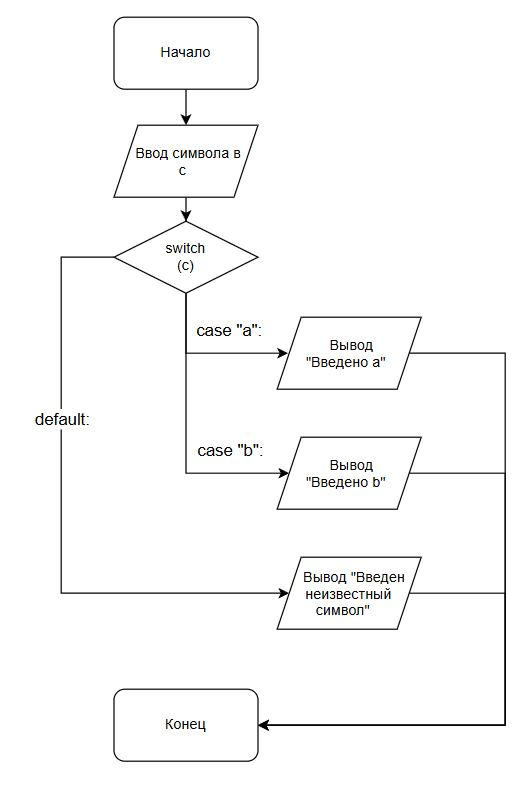

# Домашнее задание к работе 7
____

## Условие задачи
____

Составить программу, которая в зависимости от значения школьной
оценки выводит словесное наименование ( плохо, неудовлетворительно,
посредственно, хорошо, отлично).

## Реализация программы

```c
#include <stdio.h>
#include <locale.h>
#define _CRT_SECURE_NO_DEPRECATE

int task();

int main() {

	// Кодировка
	setlocale(LC_ALL, ".UTF-8");

	task();

	return 0;
}

int task() {
	int x;

	printf("Введите оценку: ");

	scanf("%d", &x);


	switch (x) {

	case 1:
		printf("Плохо\n");
		break;

	case 2:
		printf("Неудовлетворительно\n");
		break;

	case 3:
		printf("Посредственно\n");
		break;

	case 4:
		printf("Хорошо\n");
		break;

	case 5:
		printf("Отлично\n");
		break;

	default:
		printf("Если что тут про пятибалльную\n");
	}

	return 0;
}

```

## 3. Блок-схема из задания 1



[Ссылка на блок-схему](https://app.diagrams.net/#G11S2yHyYQMCB_zKZtUJAxYpsvejau0dvM#%7B%22pageId%22%3A%22PPpXGIrxo9YvdWrg5bHD%22%7D)

## 4. Информация о разработчике

**Терентьев Максим**
**бТИИ-262**
